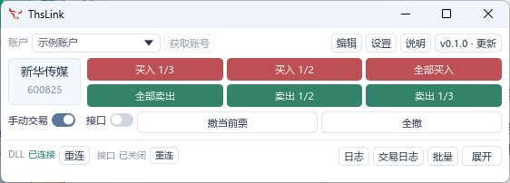
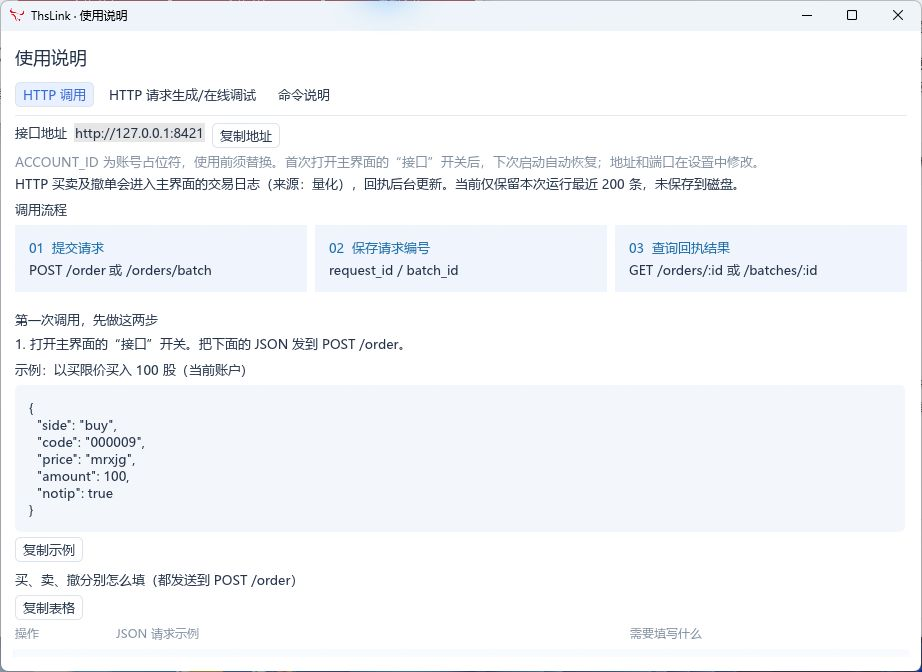
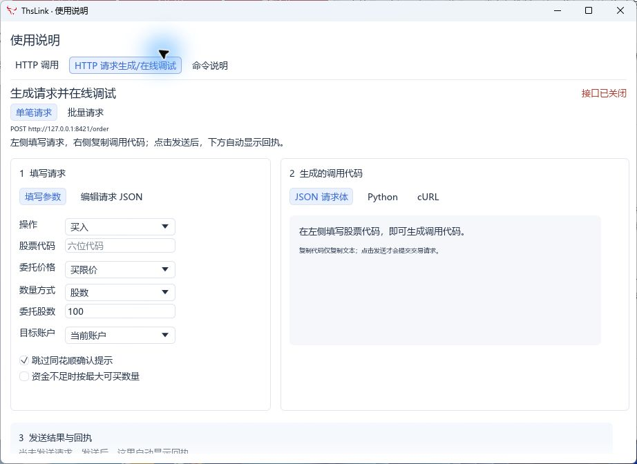

<p align="center"></p>

# ThsLink

同花顺快捷下单工具，支持桌面快捷操作、HTTP 单笔与批量调用、后台回执查询。Windows 绿色便携版，解压后双击 EXE 使用，无需安装。

**仅限个人非商业学习与研究，禁止用于任何商业行为。此仓库提供软件下载和说明，不包含应用源码。**

[下载最新版](https://github.com/electkismet/thslink/releases/latest) · [HTTP 调用说明](docs/HTTP.md) · [许可](LICENSE.md)

## 界面预览

### 主界面



快捷买卖、撤单、账户选择、接口开关与 DLL 连接状态集中在小窗口中；编辑、设置、说明为独立弹窗。截图中账户信息已替换为示例。

### HTTP 说明与调试





可填写参数或编辑 JSON，生成 JSON、Python、cURL 调用代码，支持单笔和批量。点击发送会实际提交请求，下方显示结果并查询后台回执。

## 主要功能

| 功能 | 支持内容 |
|---|---|
| 单笔 / 批量 | 买入、卖出、指定股票撤单、全撤；每批 1～20 笔 |
| 价格 | 买卖限价、买一至买五、卖一至卖五、最新价、涨跌停价、自定义价格 |
| 委托数量 | 股数、金额、可用资金 / 可卖数量比例、总资产比例、交易后的目标仓位 |
| 账户 | 当前账户、指定已登录账户、全部已登录账户 |
| HTTP | 本机或局域网调用，可配置监听地址、端口和 API 密钥 |
| 回执 | 后台接收钩子回执，按请求编号或批次编号查询 |
| 快捷操作 | 自定义按钮、按键录制、组合快捷键、批量编辑 |
| 更新 | 用户手动检查 GitHub 更新，保留配置，无后台自动检测 |

## 下载与启动

1. 从 [Releases](https://github.com/electkismet/thslink/releases/latest) 下载 `thslink-windows.zip`，解压到有写入权限的目录。
2. 保留整个目录，双击 `thslink.exe`。`thslink_bridge.dll`、`thslink-load.exe` 也需放在同一目录。
3. 启动同花顺并登录交易账户，ThsLink 连接到 `xiadan.exe`。运行环境：Windows 10/11 x64，桥接组件用于 32 位交易端。
4. 如需 HTTP，打开“接口”开关；如只用 HTTP，可关闭“手动交易”，停止自动读票与交易热键。

首次开启接口后状态会保存；以后启动自动恢复。配置保存在 `%APPDATA%/thslink/ui-settings.json`，移动程序或升级不会清空配置。

## HTTP 快速上手

默认地址 `http://127.0.0.1:8421`。下列示例为 **买限价买入 100 股**，发给 `POST /order`：

```json
{"side":"buy","code":"000009","price":"mrxjg","amount":100,"notip":true}
```

卖出把 `side` 改为 `sell`、`price` 改为 `mcxjg`。撤单只填方向与代码，例如全撤当前账户：

```json
{"side":"cancel","code":"all","notip":true}
```

### 一次提交多笔

将各笔请求放在 `orders` 数组，发送到 `POST /orders/batch`：

```json
{
  "orders": [
    {"side":"buy","code":"000009","price":"mrxjg","amount":100,"notip":true},
    {"side":"buy","code":"600000","price":"mrxjg","cw":"1/10","notip":true}
  ]
}
```

| 接口 | 用途 |
|---|---|
| `POST /order` | 单笔买卖撤 |
| `POST /orders/batch` | 批量提交 |
| `GET /orders/:id` | 按 request_id 查询单笔回执 |
| `GET /batches/:id` | 按 batch_id 查询整批与逐笔状态 |
| `GET /health` | 查询连接状态 |
| `GET /who` | 获取账户信息 |

**接收请求、提交命令、回执确认是不同状态。** 保存返回编号，再查询结果；通信超时后先核对原请求，不要直接重复提交。批量不是原子事务，一笔失败不会撤销其他已提交的委托。

比例参数 `cw`、`zzc`、`zcw` 支持小数或字符串分数，如 `0.1` 或 `"1/10"`。`zcw` 表示交易后这只股票还剩多少仓位；价格必填，数量方式只选一种。全部参数、账户范围和调用示例见 [HTTP 调用说明](docs/HTTP.md)。

局域网使用时，在设置里将监听地址设为 `0.0.0.0`，客户端使用这台电脑的实际局域网 IP。可配置 API 密钥，请求携带 `X-API-Key`；Windows 防火墙须允许该端口。

## 更新与数据保存

点击版本旁的更新入口，由用户手动检查、下载和安装。**更新请确保网络可以访问 GitHub。** 无启动检查或定时检查；完整更新同时替换 EXE、DLL 与加载器，安装前退出同花顺和其他 ThsLink 实例。

软件内历史用于查看本次运行状态，不持久保存交易流水。长期日志请由 HTTP 调用程序保存请求、返回编号和回执。个人账户配置、密钥和日志不随下载包分发。

## 许可与第三方组件

ThsLink 只允许个人非商业学习研究使用，禁止商业用途，未经书面许可不得再分发。详见 [LICENSE.md](LICENSE.md)。第三方组件适用各自许可证，见 [第三方许可说明](docs/THIRD_PARTY_NOTICES.md)。
